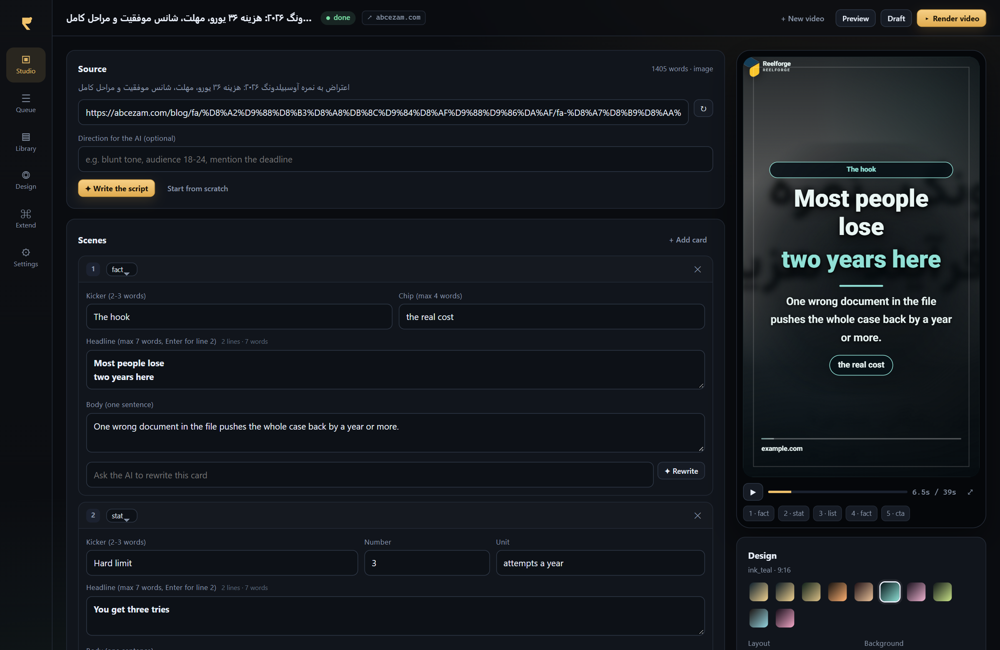

# Reelforge

**Turn an article into a finished vertical short video — with a real editor, your own AI key, and no command line.**

Reelforge is a desktop studio for making the kind of short videos that carry a whole idea in 40 seconds:
a hook card, four value cards, and a call to action, each one animated, music-bedded and rendered to
1080×1920. Give it a URL, a pasted text, or a sitemap of fifty URLs. It writes the script (or lets you
write it), composes the page, and renders the mp4 — on your machine, with your keys, at zero cost per video.



---

## Why another video tool?

Because the two things that actually take time are not the editing: they are **writing 40 cards a week that
do not sound like the same card**, and **not having to touch every single video**. Reelforge is built around
those two:

- **A design system, not a template.** 8 themes × 6 layouts × 6 backgrounds × 5 transitions × 4 frames ×
  4 brand placements, plus footage and music pools. A reachable space of ~90 000 looks. The picker is
  seeded per video and refuses anything used in the last 24 renders, so a feed never looks like one
  template repeated.
- **A queue that runs itself.** Paste 30 URLs, walk away, come back to 30 mp4s. It retries, survives a
  crashed render, and stops only when *you* asked it to stop and review.
- **Human in the loop when you want it.** Every card is editable; one sentence ("make the hook angrier")
  rewrites a single card with the model. A review gate pauses the queue before rendering.
- **Nothing is locked.** Your key, your assets, your prompts, your Python/JS hooks. The whole pipeline is
  MIT and about 3 000 lines of readable code.

## What it does

| | |
|---|---|
| **Input** | an article URL (main text + lead image extracted), pasted text, or a sitemap with a URL filter |
| **Script** | AI writes 5–6 cards with a hook, value cards and a CTA; or you write them; or a hook generates them |
| **Design** | theme / layout / background / transition / frame / logo placement / aspect (9:16, 4:5, 1:1, 16:9) |
| **Preview** | the real composed page, animated, inside the app — what you see is what renders |
| **Render** | headless Edge/Chrome + ffmpeg → H.264 + AAC mp4, cover frame embedded |
| **Publish** | one-click caption + hashtags, copy to clipboard, or hand it to your own uploader through a hook |

## Install

### Windows (single file)

1. Download `Reelforge.exe` from [Releases](../../releases).
2. Put **ffmpeg** somewhere on `PATH` — or drop `ffmpeg.exe`/`ffprobe.exe` next to the app in a `bin\` folder.
   (`winget install Gyan.FFmpeg` is the quickest way.)
3. Double-click. Edge is already on Windows, so there is nothing else to install.

Reelforge stores its data in `%LOCALAPPDATA%\Reelforge` (projects, output, assets, hooks, themes).
To make it portable, create a folder named `data` next to the exe — everything then stays beside the app.

> Windows may show a SmartScreen warning for an unsigned exe. *More info → Run anyway*, or build it
> yourself from source (below) in two minutes.

### From source (Windows / macOS / Linux)

```bash
git clone https://github.com/<you>/reelforge && cd reelforge
python -m venv .venv && .venv/Scripts/pip install -r requirements.txt   # macOS/Linux: .venv/bin/pip
.venv/Scripts/python run.py
```

Requires Python 3.11+, **ffmpeg**, and Chrome, Chromium or Edge (Reelforge drives it headlessly — no
Chromium download, no Node, no Electron).

Build the exe yourself:

```bash
.venv/Scripts/pip install pyinstaller
.venv/Scripts/pyinstaller --clean --noconfirm packaging/reelforge.spec
# → dist/Reelforge.exe
```

## Three ways to run it

| mode | what happens |
|---|---|
| **Manual** (default in Studio) | you paste a link, read the cards, fix them, press *Render* |
| **Review gate** | the queue writes every script and stops; you approve each one in the Studio |
| **Hands-off** | URLs go in, mp4s come out; scripts are written, rendered and captioned without a click |

The switches live in **Queue** and **Settings → Automation**.

## Bring your own AI

Settings → AI. Any of these works out of the box:

| provider | how |
|---|---|
| OpenAI | `https://api.openai.com/v1` + `gpt-4o-mini` / `gpt-4.1` |
| OpenRouter | `https://openrouter.ai/api/v1` + any model slug |
| Groq / DeepSeek / xAI / Together / Mistral / Fireworks | their OpenAI-compatible base URL |
| Anthropic | provider *Anthropic*, `claude-3-5-sonnet-latest` |
| Google Gemini | provider *Gemini*, `gemini-2.0-flash` |
| Ollama / LM Studio / vLLM (local, free) | `http://127.0.0.1:11434/v1` + your local model |

Keys are encrypted with Windows DPAPI before they touch the database — they cannot be read on another
machine or by another Windows user. Nothing is sent anywhere except your chosen provider.

**No key?** Choose *No AI* and write the cards yourself, or drop a `before_script.py` hook and generate
them with your own code. The app is fully usable without a model.

## Assets (all optional)

Reelforge renders with nothing but its own fonts: gradient or article-photo backgrounds, silent video.
Drop files into the asset folder (Settings → Paths → *Open folder*) to make it richer:

```
assets/
  broll/    .mp4 clips, named by topic: china-01.mp4 · money-02.mp4 · student-03.mp4
  music/    .mp3 beds — one is picked per video and looped underneath
  sfx/      whoosh.mp3 · tick.mp3 · thump.mp3  (three starter sounds ship with the app)
  logo.png  your logo, drawn on every card
```

The renderer matches a card's words to the clip names, so a card about visas pulls `visa-*.mp4` and a card
about money pulls `money-*.mp4`.

## Hooks: your own code in the pipeline

Drop a file in the hooks folder and it runs at that stage. Python (in-process interpreter, so it works in
the packaged exe too) or JavaScript (via Node).

```python
# hooks/before_render.py
def run(payload):
    return {"design": {"theme": "ink_teal", "layout": "editorial"}}
```

| stage | receives | can return |
|---|---|---|
| `before_script` | `project, article, config` | `{"script": {...}}` — replaces the AI entirely |
| `before_render` | `project, script, design, brand` | any of `script`, `design`, `brand` |
| `after_render` | `project, video, cover, meta` | `{"url": "…"}` — publish, upload, file it |

Working examples live in [`hooks/examples/`](hooks/examples) and are copied into your hooks folder on
first run. A hook that crashes or hangs is logged and skipped: it can never break a render.

## How it works

```
URL / text ─▶ extract main text + image ─▶ AI writes the script ─▶ compose ONE html page
                                                                     (GSAP timeline, 1080×1920)
                                                                              │
        mp4 + cover ◀─ ffmpeg (x264 + music mix) ◀─ headless Chrome screenshots every frame
```

The page *is* the video. The same file is shown in the Studio as a live preview and seeked frame-by-frame
by the renderer, so preview and output cannot drift apart. That is also why the app ships with no video
engine: it needs a browser and ffmpeg, both of which you already have.

Read [docs/ARCHITECTURE.md](docs/ARCHITECTURE.md) for the internals.

## Notes and limits

- **Silent by design.** Short-form feeds are watched muted; Reelforge writes cards, not voiceover. Music
  and sound effects are mixed in. A voiceover stage is on the roadmap (hooks can bolt one on today).
- **Speed.** A 45-second video renders in roughly 2–3 minutes on a laptop (about 1 500 frames, one
  screenshot each). *Draft* mode is ~3× faster at half resolution.
- **Text quality is the model's job.** The app enforces the structure (7-word headlines, one-sentence
  bodies, CTA kept verbatim) and fixes what it can, but a weak model writes weak cards. Edit the prompt
  templates in **Extend** if you want a different voice.

## Roadmap

- [ ] voiceover stage (edge-tts / Piper, per-scene)
- [ ] direct publish to YouTube Shorts, Instagram, Aparat
- [ ] brand kits (fonts + colours + logo) shared across projects
- [ ] scene-level animation presets
- [ ] Linux/macOS builds in CI

## Contributing

Issues and PRs are welcome — see [CONTRIBUTING.md](CONTRIBUTING.md). Small, focused changes with a
screenshot beat large refactors.

## License

MIT. Fonts: [Vazirmatn](https://github.com/rastikerdar/vazirmatn) (OFL-1.1). GSAP is included under its
standard no-charge licence. No stock footage or music is bundled — the sound effects are synthesised by
`packaging/build_assets.py`.
